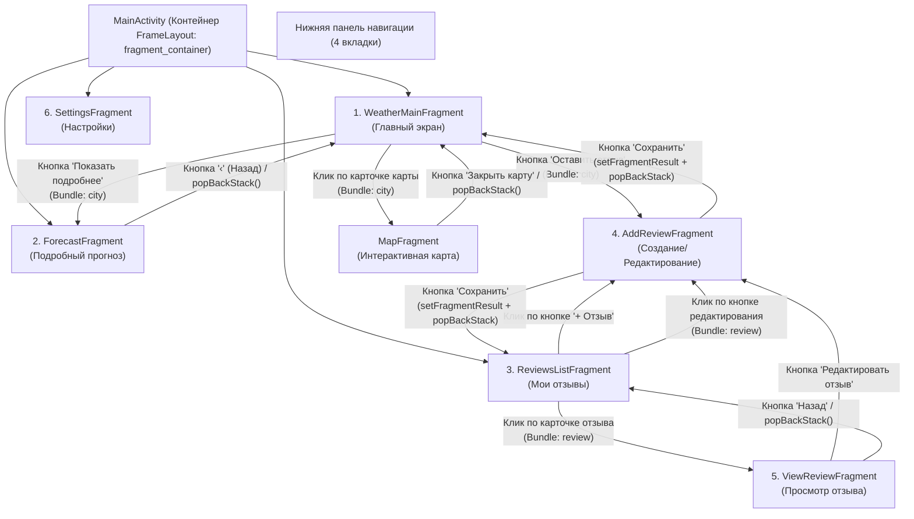

# Отчёт по Лабораторной работе №9: «Работа с фрагментами (Fragment)»

**Предметная область:** Мобильное приложение «Прогноз погоды» (`WeatherTracker`)  
**Ветка в Git:** `lab9`  
**Архитектурный паттерн:** Single-Activity Architecture (Хост-Activity `MainActivity` + набор независимых UI-фрагментов `Fragment`)

---

## 1. Что нужно было сделать в работе (согласно требованиям)

В рамках лабораторной работы требовалось:
1. **Подключить библиотеку Fragment** в проект.
2. **Создать фрагменты** пользовательского интерфейса (минимум два фрагмента, в нашем проекте — все 6 экранов плюс интерактивная карта).
3. **Настроить контейнер в хост-Activity**: разместить в `activity_main.xml` контейнер `FrameLayout` для динамической замены фрагментов.
4. **Реализовать динамическую навигацию**:
   - Управление заменой фрагментов через `supportFragmentManager` и `FragmentTransaction`.
   - Использование метода `addToBackStack(null)`, чтобы системная кнопка «Назад» и кнопки на экранах корректно возвращали пользователя к предыдущему фрагменту.
5. **Выполнить задания повышенной сложности**:
   - Реализовать передачу данных между фрагментами (передача аргументов через `Bundle` и возврат результатов через `Fragment Result API`).
   - Добавить плавные кастомные анимации при смене фрагментов (`setCustomAnimations`).
6. **Убрать лишние `Activity`**, оставив приложение в архитектуре Single-Activity.

---

## 2. Текстовое описание назначения каждого фрагмента

В приложении все экраны переведены на фрагменты. Всего реализовано 7 фрагментов:

1. **`WeatherMainFragment` (Экран 1: Главный экран погоды)**
   - **Назначение:** Служит стартовым экраном приложения. Отображает строку поиска города, текущую погоду (температуру, ощущение, статус осадков), карточку метеоданных (скорость ветра, влажность воздуха, атмосферное давление), карточку превью интерактивной карты, кнопки перехода к подробному прогнозу и к созданию отзыва.
   - **Особенность:** Содержит плашку-уведомление о последнем оставленном отзыве, которая автоматически появляется через `Fragment Result API` и закрывается по нажатию или через 4 секунды.

2. **`ForecastFragment` (Экран 2: Подробнее о погоде)**
   - **Назначение:** Предоставляет расширенный метеорологический прогноз для выбранного города.
   - **Содержимое:** Строка поиска для быстрой смены города, горизонтальная прокручивающаяся лента с почасовым прогнозом (иконки погоды ☀️/⛅/🌧️/❄️, время и температура), а также вертикальный список детального прогноза на 7 дней недели (температура день/ночь, осадки, ветер, влажность, давление).
   - **Навигация:** Принимает название города через `Bundle arguments`, имеет кнопку возврата «‹» (`popBackStack`).

3. **`ReviewsListFragment` (Экран 3: Мои отзывы)**
   - **Назначение:** Экран просмотра и управления списком отзывов пользователей о совпадении прогнозов погоды с реальностью.
   - **Содержимое:** Панель управления (сортировка по дате/городу, фильтрация по статусу «Совпало» / «Не совпало», сброс фильтров), кнопка «+ Отзыв», список `RecyclerView` с кастомными карточками отзывов, кнопки редактирования и удаления с диалогом подтверждения, а также блок пагинации.
   - **Навигация:** При клике на карточку открывает экран просмотра `ViewReviewFragment`, при клике на карандаш — редактирование `AddReviewFragment`.

4. **`AddReviewFragment` (Экран 4: Оставить / редактировать отзыв)**
   - **Назначение:** Экран ввода и сохранения отзыва пользователя о погоде. Может работать в двух режимах: создание нового отзыва или редактирование существующего.
   - **Содержимое:** Поле ввода заголовка, выпадающий список городов с автодополнением (`AutoCompleteTextView`), кнопки вызова системных диалогов выбора даты (`DatePickerDialog`) и времени (`TimePickerDialog`), переключатель статуса («Совпало» / «Не совпало»), многострочное поле для текста комментария, кнопки «Сохранить» и «Отмена».
   - **Навигация:** После сохранения отправляет данные обратно в вызывающий фрагмент через `setFragmentResult("review_added", bundle)` и вызывает `parentFragmentManager.popBackStack()`.

5. **`ViewReviewFragment` (Экран 5: Просмотр отзыва)**
   - **Назначение:** Экран детального чтения одного конкретного отзыва.
   - **Содержимое:** Заголовок отзыва, город, дата и время, цветной бейдж статуса (зеленый для «Совпало», красный для «Не совпало»), полный текст комментария, кнопка «Редактировать отзыв» и кнопка «Вернуться к списку».
   - **Навигация:** Принимает объект отзыва через `Bundle arguments`.

6. **`SettingsFragment` (Экран 6: Настройки)**
   - **Назначение:** Экран пользовательских настроек приложения.
   - **Содержимое:** Выпадающий список выбора языка интерфейса (`Spinner`), переключатель темы оформления (Светлая / Тёмная), радио-группы выбора единиц измерения (температура: °C / °F; ветер: м/с / км/ч; давление: мм рт. ст. / гПа), переключатель push-уведомлений о штормовых предупреждениях и кнопка «Сохранить настройки».

7. **`MapFragment` (Экран интерактивной карты)**
   - **Назначение:** Полноэкранный просмотр интерактивной карты метеорадара с наложением слоев облачности и осадков для выбранного города.
   - **Содержимое:** Метка города с текущей температурой, плавающие кнопки зума (+ / -) и кнопка «Закрыть карту», возвращающая на предыдущий экран.

---

## 3. Схема навигации между фрагментами



### Принцип работы навигации:
- **Переключение корневых разделов:** Нажатие на вкладку в нижней панели (`Погода`, `Прогноз`, `Отзывы`, `Настройки`) вызывает `switchTab()` в `MainActivity`, очищает предыдущий BackStack и плавно сменяет корневой фрагмент.
- **Вложенные переходы:** Вызовы `openFragment(fragment, addToBackStack = true)` заменяют фрагмент в `fragment_container` с добавлением транзакции в BackStack и проигрыванием анимаций сдвига `R.anim.slide_in_right` / `R.anim.slide_out_left`.
- **Возврат назад:** Вызов `parentFragmentManager.popBackStack()` или нажатие системной кнопки «Назад» восстанавливает предыдущий фрагмент из стека с обратной анимацией `R.anim.slide_in_left` / `R.anim.slide_out_right`.
- **Синхронизация:** `MainActivity.addOnBackStackChangedListener` определяет текущий отображаемый фрагмент и автоматически подсвечивает соответствующую иконку на нижней панели навигации.

---

## 4. Как продемонстрировать работу приложения и какие скриншоты нужны

### Сценарий демонстрации работы:

1. **Запуск и Главный экран:**
   - Приложение запускается без зависаний, открывается `WeatherMainFragment`.
   - В поле поиска введите город (например, «Санкт-Петербург») и нажмите «Найти» — данные температуры, влажности и ветра обновятся.
2. **Переход в подробный прогноз:**
   - Нажмите «Показать подробнее» — с плавной анимацией откроется `ForecastFragment`. Продемонстрируйте горизонтальную прокрутку почасовых карточек и вертикальный список дней.
   - Нажмите стрелку «‹» в левом верхнем углу — произойдет возврат на главный экран благодаря `popBackStack()`.
3. **Открытие интерактивной карты:**
   - Нажмите на карточку «Интерактивная карта осадков» — откроется `MapFragment`. Продемонстрируйте кнопки зума (+/-) и нажмите «Закрыть карту».
4. **Добавление отзыва и возврат данных:**
   - Нажмите кнопку «Оставить отзыв» на главном экране — откроется `AddReviewFragment`.
   - Заполните форму: выберите дату через календарь, укажите город, статус «Совпало» и текст комментария, нажмите «Сохранить».
   - Фрагмент закроется, произойдет возврат на главный экран, где внизу появится зеленая плашка: `✓ Добавлен отзыв: «...»`.
   - Нажмите на крестик плашки или подождите 4 секунды — плашка плавно скроется.
5. **Просмотр, редактирование и фильтрация отзывов:**
   - Перейдите на вкладку «Отзывы» (откроется `ReviewsListFragment`). В списке будет ваш добавленный отзыв.
   - Нажмите на карточку отзыва — откроется `ViewReviewFragment` (Экран 5).
   - Нажмите «Редактировать отзыв» — откроется `AddReviewFragment` с заполненными полями отзыва.
   - Вернитесь назад и проверьте фильтрацию: нажмите «Фильтр» → «Только Совпало», затем «Сброс».
6. **Настройки:**
   - Перейдите на вкладку «Настройки» (`SettingsFragment`), переключите тумблер темной темы, смените язык в Spinner и нажмите «Сохранить настройки».

---

### Таблица скриншотов для отчёта:

| № | Скриншот | Что должно быть видно на скриншоте |
|---|---|---|
| **1** | **Главный экран (`WeatherMainFragment`)** | Сводка погоды города Москва (+18°C, ясно), строка поиска, параметры (ветер, влажность, давление), превью карты, нижняя панель с активной первой вкладкой. |
| **2** | **Экран подробного прогноза (`ForecastFragment`)** | Горизонтальная лента с часами и погодными значками (☀️, ⛅, 🌧️), ниже список карточек прогноза на 7 дней с датами и осадками. |
| **3** | **Экран «Мои отзывы» (`ReviewsListFragment`)** | `RecyclerView` со списком отзывов, кнопки «Сортировка», «Фильтр», «Сброс», кнопка «+ Отзыв», цветные бейджи («Совпало» — зеленый, «Не совпало» — красный). |
| **4** | **Экран формы отзыва (`AddReviewFragment`)** | Форма с заполненным заголовком, выпадающим списком городов, датой из `DatePickerDialog`, переключателем статуса и текстом комментария. |
| **5** | **Экран детального просмотра отзыва (`ViewReviewFragment`)** | Карточка с полным текстом комментария, городом, датой, бейджем статуса и кнопками «Редактировать отзыв» и «Вернуться к списку». |
| **6** | **Экран настроек (`SettingsFragment`)** | Выпадающий список выбора языка, переключатель темы, радио-кнопки единиц измерения (°C, м/с, мм рт. ст.) и тумблер уведомлений. |
| **7** | **Демонстрация передачи данных и `popBackStack`** | Главный экран сразу после нажатия «Сохранить» в форме отзыва: внизу отображается зеленая плашка подтверждения `✓ Добавлен отзыв: «...»` (результат `Fragment Result API`). |

---

## 5. Контрольные вопросы (в точности по методичке) и ответы на них

### 1. Чем фрагмент отличается от `Activity`?
- **Автономность:** `Activity` — это самостоятельный системный компонент верхнего уровня, регистрируемый в файле `AndroidManifest.xml` и управляемый операционной системой Android. `Fragment` не может существовать самостоятельно — он всегда привязан к жизненному циклу хост-`Activity` и управляется её `FragmentManager`.
- **Жизненный цикл:** У `Fragment` есть дополнительные стадии жизненного цикла, связанные с созданием и уничтожением его графического представления (View): `onCreateView()`, `onViewCreated()`, `onDestroyView()`. Это позволяет кэшировать сам экземпляр фрагмента в памяти (например, в BackStack), уничтожая только его тяжелые View-элементы.
- **Гибкость и повторное использование:** Внутри одной `Activity` можно динамически заменять фрагменты в контейнере или размещать сразу несколько фрагментов одновременно (например, список и детальный просмотр на широких экранах планшетов).

### 2. Зачем используется `FrameLayout` как контейнер для фрагментов?
- `FrameLayout` — это самый легковесный и производительный ViewGroup в Android, оптимизированный для удержания одного дочернего корневого элемента.
- При динамической навигации контейнер выступает исключительно «посадочным местом» (плейсхолдером с уникальным `android:id="@+id/fragment_container"`), в который `FragmentManager` инфлейтит разметку активного фрагмента.
- При использовании `replace()` содержимое `FrameLayout` очищается и заменяется представлением нового фрагмента без накладных расходов на сложные пересчеты связей (в отличие от `ConstraintLayout` или `RelativeLayout`).

### 3. Какой метод `FragmentManager` позволяет заменить один фрагмент другим?
Замена одного фрагмента другим выполняется с помощью метода:
```kotlin
supportFragmentManager.beginTransaction()
    .replace(R.id.fragment_container, newFragment)
    .commit()
```
Метод **`replace()`** удаляет все существующие в указанном контейнере фрагменты и добавляет на их место новый переданный фрагмент.

### 4. Зачем вызывается `addToBackStack()`?
- Метод `transaction.addToBackStack(name)` вызывается для того, чтобы сохранить транзакцию фрагментов в стеке возврата (`FragmentManager BackStack`).
- Благодаря этому при нажатии системной кнопки «Назад» на устройстве (или вызове `popBackStack()`):
  - Приложение не закрывается,
  - `FragmentManager` извлекает последнюю операцию из стека и откатывает её, возвращая пользователя к предыдущему отображавшемуся фрагменту в его исходном состоянии.

### 5. Может ли фрагмент существовать без `Activity`?
**Нет, фрагмент не может существовать без `Activity`.**  
Фрагмент жестко привязан к своей хост-Activity (`Host`). Ему необходим контекст (`Context`) хост-активити для инфлейта разметки, доступа к ресурсам, темам оформления и системным сервисам. Если хост-Activity уничтожается системой (вызов `onDestroy()`), автоматически уничтожаются и все прикрепленные к ней фрагменты.
